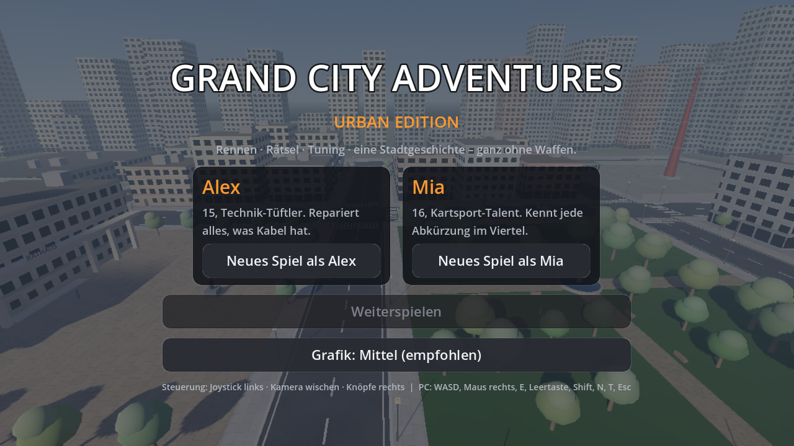
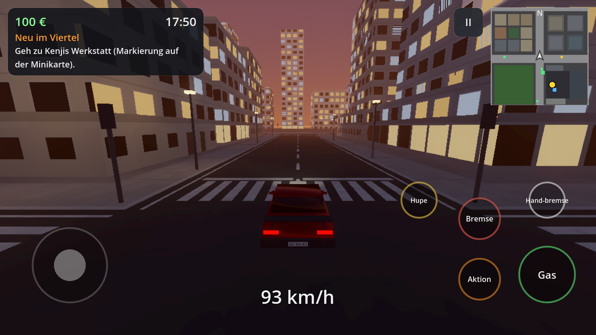
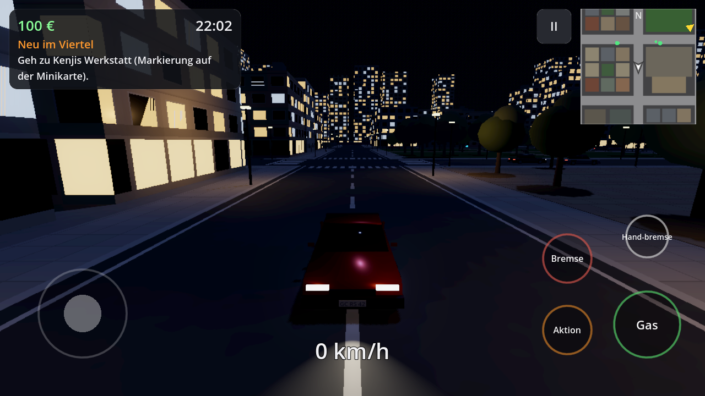
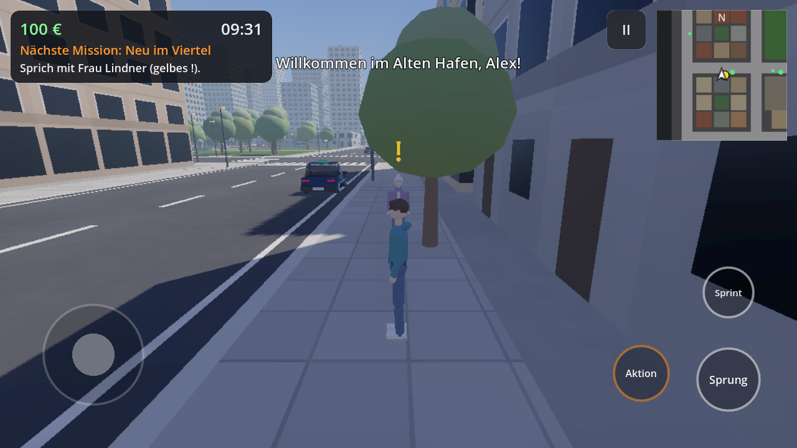
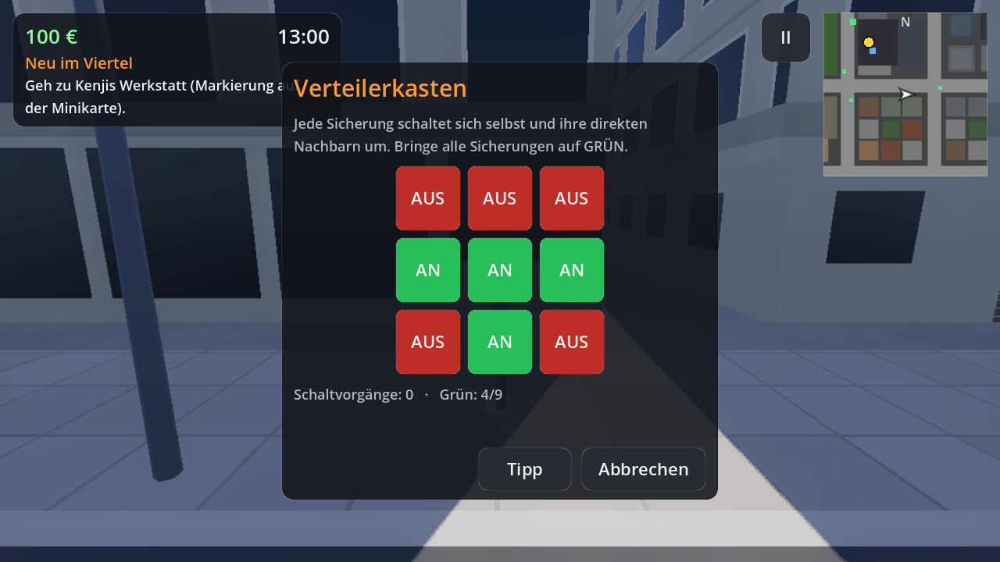
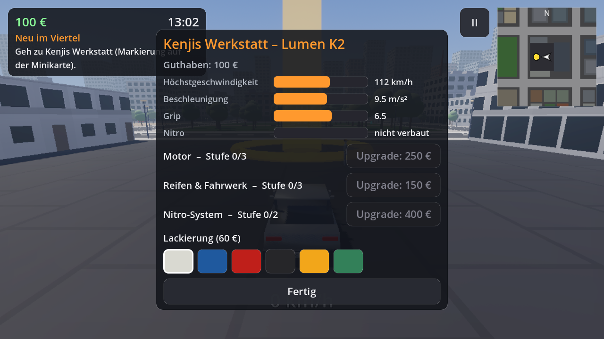

# Grand City Adventures – Urban Edition

Ein spielbares 3D-Open-World-Spiel für Smartphones (ab 12 Jahren), gebaut mit **Godot 4.5** und **GDScript**.
Bewegungsfreiheit wie in großen Stadt-Sandbox-Spielen – aber **ohne Waffen, Blut oder Gewalt**. Stattdessen:
eine Stadtgeschichte um ein rätselhaftes Störsignal, Zeitrennen, technische Rätsel, Lieferfahrten,
Fahrzeug-Tuning und Erkundung.

| Hauptmenü | Abendfahrt | Nacht |
|---|---|---|
|  |  |  |
| **Start mit Missionsgeberin** | **Sicherungs-Rätsel** | **Tuning** |
|  |  |  |

Die Screenshots werden automatisch mit `tools/run_screenshots.sh` gerendert.

---

## MVP-Umfang (Status)

| # | Funktion | Umsetzung |
|---|---|---|
| 1 | Stadtviertel ca. 400 × 400 m | „Alter Hafen“: 4 × 4 Blöcke im 90-m-Straßenraster, Wohnviertel, City-Ring, Park, Rathausplatz, Werkstatt, Gewerbehof mit Funkturm, Hafen; Skyline und Wasser als Kulisse |
| 2 | Zwei spielbare Figuren | **Alex** (Technik-Tüftler) und **Mia** (Kartsport-Talent); die jeweils andere Figur erscheint als NPC in der Story; Wechsel im Pause-Menü |
| 3 | Third-Person-Kamera + Touch | SpringArm-Kamera (weicht Wänden aus), Multi-Touch: dynamischer Joystick, Wisch-Kamera, runde Aktionsknöpfe; zusätzlich Tastatur/Maus/Gamepad |
| 4 | Zwei Autos, Arcade-Physik | **Lumen K2** (Kompakt) und **Vireo RS** (Sportcoupé); Längs-/Quergrip-Modell mit Driften, Handbremse, Nitro |
| 5 | Ein-/Aussteigen, Tuning | Aktion-Knopf; Werkstatt: Motor (3 Stufen), Reifen & Fahrwerk (3), Nitro (2), Lackierung (6 Farben) |
| 6 | Fünf Missionen mit Story | Neu im Viertel · Die Hafenrunde (Rennen) · Kurzschluss (Rätsel) · Ersatzteile im Eiltempo (Zeit-Lieferung) · Das Störsignal (Frequenz-Rätsel + Zeitdruck-Finale) |
| 7 | NPCs mit Dialogen und Tagesabläufen | 12 NPCs, Dialoge je Tageszeit, Rundgänge, nachts zu Hause; weichen fahrenden Autos aus |
| 8 | Minikarte, Ziele, Fortschritt, Belohnungen | Spielerzentrierte Minikarte mit Zielpfeil, Missionsziel-Panel, Timer, Checkpoints, Geld, Abschluss-Panel, 12 Energiezellen zum Sammeln |
| 9 | Tag-Nacht-Wechsel | 24-Minuten-Tag, Sonnen-/Mondlicht, prozeduraler Himmel, Dämmerung, leuchtende Fenster, Straßenlaternen, Scheinwerfer |
| 10 | Lokales Speichern/Laden | JSON unter `user://savegame.json`, Autosave nach jeder Mission, Weiterspielen im Hauptmenü |

## Schnellstart

1. **Godot 4.5** (Standard-Version, nicht .NET) installieren: <https://godotengine.org/download>
2. Projektordner in Godot importieren (`project.godot`) und **F5** drücken.

Ohne Editor:

```bash
godot --path .
```

### Steuerung

| Aktion | Touch | Tastatur / Maus | Gamepad |
|---|---|---|---|
| Laufen / Lenken | Joystick (linke Bildschirmhälfte) | WASD / Pfeiltasten | linker Stick |
| Kamera | auf der rechten Hälfte wischen | rechte Maustaste + ziehen, `C` = zurücksetzen | – |
| Aktion (Sprechen, Einsteigen, Rätsel) | **Aktion** | `E` / `F` | Y |
| Springen / Handbremse | **Sprung** / **Handbremse** | Leertaste | A |
| Sprinten | **Sprint** | Shift | LB |
| Gas / Bremse (Auto) | **Gas** / **Bremse** (oder Joystick vor/zurück) | W / S | Stick |
| Nitro | **Nitro** (nach Einbau) | `N` / Strg | RB |
| Tuning in der Werkstatt | Knopf „Tuning öffnen“ | `T` | X |
| Pause / Speichern | **II** | `Esc` / `P` | Start |

## Tests

74 automatisierte Tests (Unit + Integration), ohne externe Abhängigkeiten:

```bash
GODOT=/pfad/zu/godot tools/run_tests.sh
```

Einzelne Suite: `tools/run_tests.sh --suite=test_puzzles`. Der GitHub-Workflow `.github/workflows/tests.yml` führt sie bei jedem Push aus.

Abgedeckt sind u. a.:

- **Spielzustand & Speichern**: Geld, Belohnungen nur einmal, JSON-Rundlauf, beschädigte/zu neue Spielstände.
- **Stadt**: 400 m, alle Missionsorte, Checkpoints, Sammelobjekte und NPC-Wege frei von Kollisionen; deterministische Generierung; Tag/Nacht-Licht.
- **Fahrphysik** (echte Physik-Engine): Beschleunigen, Höchstgeschwindigkeit, Bremsen, Rückwärts, Lenken, Driften, Wandaufprall, Motor-Upgrade, Nitro.
- **Missionen**: Schritt-für-Schritt-Logik, Zeitlimit mit Wiederholung, komplette Story mit Belohnungssumme.
- **Hauptszene**: Menü, Figurwahl, Laufen, Touch-Joystick und Multi-Touch-Knöpfe, Dialoge, Ein-/Aussteigen, **kompletter Story-Durchlauf** inkl. Rätsel-UI, Tuning-Kauf, Sammeln, Speichern/Laden der Welt, Pause, NPC-Tagesablauf, Ausweichen.
- **KI-Fahrer**: Ein Autopilot fährt „Die Hafenrunde“ mit echter Physik durch die generierte Stadt – Ergebnis 42 s bei 80 s Zeitlimit.

Screenshots und Draw-Call-Messung (benötigt Vulkan; in CI/Containern per lavapipe):

```bash
GODOT=/pfad/zu/godot tools/run_screenshots.sh
```

## Projektstruktur

```
project.godot            Projekt (Mobile-Renderer, Querformat, Touch-Emulation)
export_presets.cfg       Export-Vorlagen Android (arm64) und Web
scenes/                  main.tscn, player/, vehicles/, npc/
scripts/
  autoload/              GameState, SaveSystem, InputSetup (Singletons)
  data/                  CityLayout, MissionData, NpcData, TuningData (rein datengetrieben)
  world/                 CityBuilder (prozedurale Stadt), DayNightCycle, MeshFactory
  player/                Player, CameraRig, HumanoidModel
  vehicles/              Car (Arcade-Physik), CarModel, EngineAudio
  npc/                   Npc (Tagesablauf, Dialog, Ausweichen)
  missions/              MissionManager, PuzzleLogic
  ui/                    Hud, TouchControls, Minimap, PuzzlePanel, TuningPanel, Theme
  main.gd                verbindet alles, Welt-Interface, Speichern/Laden
shaders/                 Fassaden, Boden/Straßen, Pflaster, Wasser (prozedural)
tests/                   Test-Runner, unit/, integration/
tools/                   Test-, Screenshot- und Performance-Skripte
docs/                    Architektur, Sprints, Performance, Assets & Lizenzen, Screenshots
```

Details: [docs/ARCHITEKTUR.md](docs/ARCHITEKTUR.md) · [docs/SPRINTS.md](docs/SPRINTS.md) ·
[docs/PERFORMANCE.md](docs/PERFORMANCE.md) · [docs/ASSETS_UND_LIZENZEN.md](docs/ASSETS_UND_LIZENZEN.md)

## Web-Version (für den eigenen Webserver)

Fertiges Paket bauen (Godot 4.5.1 + Web-Export-Vorlagen nötig):

```bash
GODOT=/pfad/zu/godot tools/export_web.sh
```

Ergebnis: `export/grand-city-adventures-web.zip` (ca. 9,5 MB gepackt, 38 MB entpackt).

**Hochladen:** ZIP entpacken und **alle Dateien** (inkl. `.htaccess`) in einen Ordner auf dem Webserver laden,
z. B. `https://deine-domain.de/spiel/`. Aufruf über `index.html`.

- Der Build ist *single-threaded*: Es sind **keine** speziellen Header (COOP/COEP) nötig, normales Webhosting reicht.
- **HTTPS** wird empfohlen (manche Browser blockieren Audio/Speicher sonst).
- Der Server muss `.wasm` als `application/wasm` ausliefern. Für Apache erledigt das die mitgelieferte `.htaccess`;
  bei nginx ggf. `types { application/wasm wasm; }` ergänzen.
- Lokales Öffnen per Doppelklick auf `index.html` funktioniert **nicht** – es braucht einen Webserver
  (Test: `python3 -m http.server` im Ordner).
- Im Browser nutzt Godot den Compatibility-Renderer (WebGL 2). Spielstände liegen im Browser-Speicher
  (IndexedDB) des jeweiligen Geräts.
- Erster Start lädt ca. 9,5 MB (mit Kompression) und braucht je nach Gerät einige Sekunden.

## Android-Build

1. In Godot: *Editor → Export-Vorlagen verwalten* → Vorlagen für 4.5 installieren.
2. Android-SDK/JDK in den Editor-Einstellungen eintragen und einen Debug-Keystore anlegen
   (siehe Godot-Doku „Exporting for Android“).
3. *Projekt → Exportieren → Android* → `export/GrandCityAdventures.apk`.

Die Vorlage exportiert nur arm64-v8a, Querformat (Sensor), Immersive Mode, ETC2/ASTC-Texturkompression.
Paketname `org.example.grandcityadventures` ist ein Platzhalter und muss vor einer Veröffentlichung ersetzt werden.

## Bekannte Einschränkungen (ehrlich dokumentiert)

- **Grafik sind Platzhalter-Assets.** Figuren, Autos und Gebäude bestehen aus selbst erzeugten Primitiven und
  prozeduralen Shadern. Proportionen, Farben, Licht und Atmosphäre sind semi-realistisch angelegt, die Modelle
  selbst aber noch kantig; es gibt kein Skinning, keine Gesichtsanimation und keine Texturen. Die Architektur ist so
  gebaut, dass `HumanoidModel` und `CarModel` später durch GLB-Modelle ersetzt werden können.
- **Nicht auf einem echten Smartphone gemessen.** In dieser Umgebung gab es weder Android-SDK noch ein Gerät;
  es wurde kein APK gebaut. Das 30-FPS-Ziel ist über ein Budget (Draw-Calls, Primitive, Lichter) abgesichert und
  mit Software-Rendering vermessen, nicht mit echter Mobil-GPU (siehe [PERFORMANCE.md](docs/PERFORMANCE.md)).
- **Touch-Steuerung** ist per simulierter Multi-Touch-Events getestet, nicht mit echten Fingern.
- **Kein Straßenverkehr**: Es fahren keine KI-Autos; NPCs laufen feste Wege (keine NavMesh-Navigation).
- **Audio**: nur ein prozedural erzeugter Motorsound; keine Musik, keine Soundeffekte.
- **Speichern mitten in einer Mission** sichert nur Fortschritt außerhalb der Mission; nach dem Laden startet die
  laufende Mission erneut beim Auftraggeber (freigeschaltete Autos bleiben erhalten).
- **Web** ist gebaut und in Chromium (Software-WebGL) getestet: Menü, Spielstart und Laufen funktionieren. Auf echten Handy-Browsern noch nicht getestet. **iOS** ist vorbereitet, aber nicht gebaut.
- **Godot-Version**: Entwickelt mit 4.5.1. Die komplette Test-Suite läuft auch mit 4.3 grün, dort werden
  2D-Zeichenbefehle aber noch nicht gebündelt (UI kostet ~2,5× mehr Draw-Calls). Empfohlen: 4.4 oder neuer.

## Inhalte & Rechte

Alle Figuren, Namen, Orte, Fahrzeuge, Texte, Shader und 3D-Assets sind eigene Arbeit für dieses Projekt.
Es werden keine geschützten Figuren, Logos, Karten oder Inhalte anderer Spiele verwendet. Details zu Engine und
Schriftart: [docs/ASSETS_UND_LIZENZEN.md](docs/ASSETS_UND_LIZENZEN.md).
